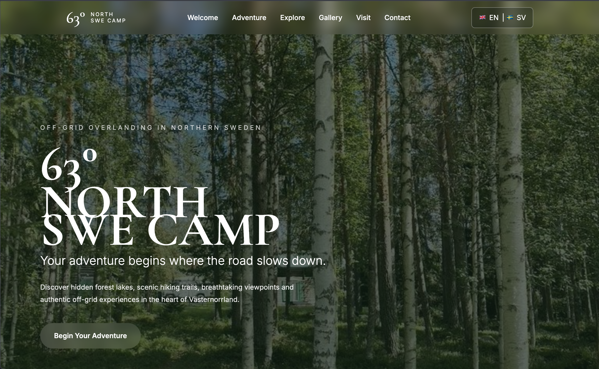

# 63° NORTH SWE CAMP
[🌐 View Live Website](https://sidneyroesch.github.io/63-north-swe-camp/)

### Off-Grid Overlanding & Outdoor Experiences in Northern Sweden

## About the Project

63° NORTH SWE CAMP is a website concept inspired by the natural beauty, outdoor lifestyle and off-grid experiences of northern Sweden.

The project explores destinations, landscapes and outdoor experiences, with a focus on nature, adventure and sustainable tourism.

## Project Goals

- Present destinations and outdoor experiences in northern Sweden.
- Create an engaging visual experience through landscape photography.
- Develop a clear and accessible website structure.
- Practise front-end development and web design principles.

## Technologies Used

- HTML5
- CSS3
- JavaScript

## Project Structure

- `index.html` – Main website structure.
- `css/` – Stylesheets.
- `js/` – JavaScript functionality.
- `images/` – Website photography and visual assets.

## Development

This project was developed as part of my web development studies and represents my practical work in front-end development.

## Author

**Sidney Roesch**

[GitHub Profile](https://github.com/sidneyroesch)
